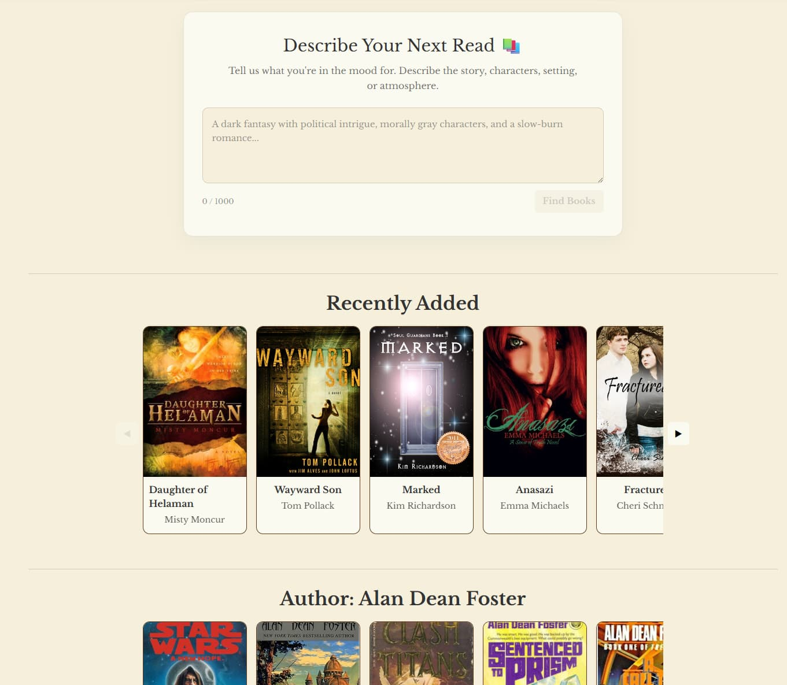
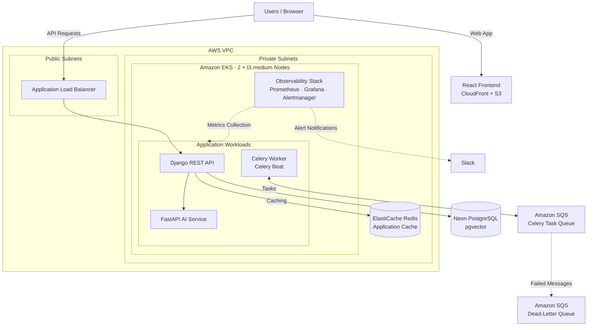
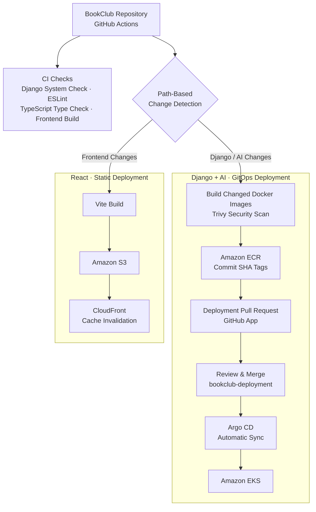
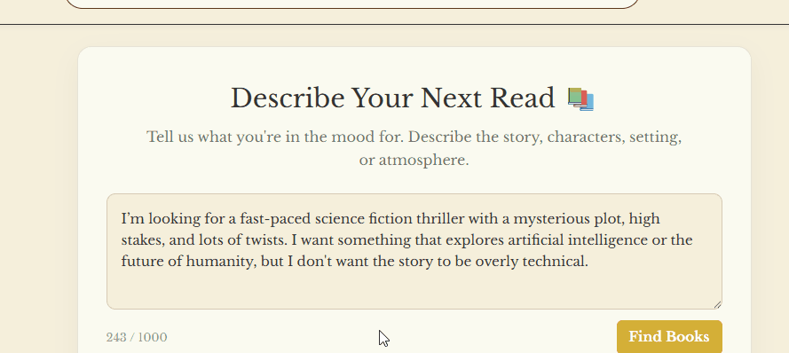

# BookClub

A full-stack book discovery and recommendation platform built with Django, React, PostgreSQL, and AI-powered semantic search.

**Live Demo:** [bookclub.sinanerbezci.com](https://bookclub.sinanerbezci.com)

**API:** [api.sinanerbezci.com](https://api.sinanerbezci.com)

  

## Overview

BookClub is a full-stack book discovery and review platform inspired by Goodreads, where users can create their own lists, write and read reviews, and use semantic search to find their next reads.

The backend is built with Django and Django REST Framework, while the frontend uses React, TypeScript, and Vite. PostgreSQL on Neon provides persistent storage, with PostgreSQL full-text search, trigram similarity, and vector search powering book discovery.

The application runs on **Amazon EKS**, with Kubernetes managing the Django API, AI service, and Celery workloads. Amazon ElastiCache (Redis) provides application caching, while Amazon SQS serves as the Celery message broker, with a dead-letter queue for failed task messages. AWS infrastructure is provisioned using **Terraform**, while **Argo CD**, **Kustomize**, and **Helm** manage Kubernetes deployments through GitOps.

**GitHub Actions** validates the application, builds and publishes container images to Amazon ECR, and creates deployment pull requests in a separate GitOps repository. After review and merge, Argo CD synchronizes the updated manifests with the EKS cluster. The React frontend is hosted on Amazon S3 and delivered through CloudFront.

For observability, **Prometheus** collects application and Kubernetes metrics, **Grafana** provides monitoring dashboards, and **Alertmanager** delivers alerts through Slack.

The AI layer provides semantic search, book recommendations, AI-generated book summaries, and LLM-generated explanations for recommendations.

## Key Features

### Core Features

- Browse books, authors, genres, and series
- Search across books, authors, and genres
- View detailed book and author information
- Create and manage personal book lists
- Write, edit, and read book reviews
- Rate books
- User authentication and account management
- Discover recently added and randomly selected books

### AI & Search

- Semantic book search using vector embeddings
- Book recommendations based on book similarity
- AI-generated book summaries using the OpenAI Batch API
- LLM-generated explanations for book recommendations
- PostgreSQL full-text search and trigram similarity for traditional search
- Vector similarity search using PostgreSQL and pgvector

## Architecture
### System Architecture

### CI/CD & GitOps Pipeline

BookClub uses **GitHub Actions** for CI/CD, with independent validation and path-based change detection to selectively trigger deployment jobs.

Pull requests run Django system checks, ESLint, TypeScript type checking, and frontend build validation. Changed Django and AI container images are also built and scanned with Trivy before merging.

On the `main` branch, changes to the Django backend or AI service trigger Docker image builds, Trivy security scans, and publishing to Amazon ECR using commit SHA tags. A **GitHub App** creates a pull request in the private GitOps repository to update the production Kustomize configuration. Once merged, **Argo CD** automatically synchronizes the changes with Amazon EKS.

Frontend changes trigger a separate Vite build, deployment to Amazon S3, and CloudFront cache invalidation. Django static files are also collected and published to S3 as part of the backend build workflow.

## AI Journey

The AI features in BookClub were developed incrementally, starting with experiments around text representation and summary generation and eventually becoming a pipeline for generating summaries, creating embeddings, performing semantic search, generating recommendations, and explaining those recommendations.

### 1. Semantic Summary Generation

We first experimented with LLM-generated book summaries. The goal was not simply to produce a shorter version of the plot, but to create a more semantic representation of the book that captures concepts such as themes, conflicts, world-building, important entities, and other characteristics that can be useful for understanding the book.

We iterated on the system prompt to influence the model toward this type of semantic summary rather than a straightforward plot explanation.

### 2. Embedding Input Experiments

Once we had generated summaries, we experimented with different representations as inputs to the embedding model.

We evaluated embeddings based on the original book description, the generated summary, and the generated summary without the title. The original descriptions often contained promotional or catalog-oriented text, while including the title could give the embedding an unnecessary influence from the book's name.

The production recommendation pipeline uses the generated summary without the title as its embedding input. Embeddings are generated using `BAAI/bge-small-en-v1.5`, producing 384-dimensional vectors.

### 3. Local Model Experiments with Ollama

We also experimented with running LLMs locally using Ollama. We tested Qwen3 4B and 8B models and benchmarked them against OpenAI's `gpt-4.1-mini`.

The local models produced good-quality summaries during experimentation. On our NVIDIA GTX 1060, Qwen3 4B averaged 5.6 seconds per book, while the 8B model averaged 9.7 seconds per book. However, generating summaries for the entire catalog would still take too long at this scale, so we chose the OpenAI Batch API for large-scale processing

### 4. Large-Scale Summary Generation with OpenAI Batch API

For generating summaries across the existing book catalog, we moved from individual API requests to the OpenAI Batch API using `gpt-4.1-mini`. The Batch API was a better fit for large-scale processing, offering a lower cost than standard API processing and allowing us to process the catalog asynchronously.

The Batch API has a limit of 2 million enqueued tokens. To handle this constraint, we implemented a token estimator using `tiktoken`. Rather than relying on the number of books in a batch, the exporter estimates the prompt-token usage of each request and builds batches up to a configured limit of 1.5 million tokens, leaving additional headroom below the API limit.

Depending on the token usage of the books in a batch, this typically resulted in around 2,500–3,000 books per batch.

The batch workflow exports requests, submits them to OpenAI, processes the resulting output files, and imports the generated summaries back into BookClub.

The complete summary-generation process took a little over two hours and cost approximately $8.60.

### 5. Semantic Search & Recommendations

#### Semantic Search

Users can describe the kind of book they are looking for using a natural-language query. The query is converted into an embedding using `BAAI/bge-small-en-v1.5`, and the system searches the book embeddings in PostgreSQL using cosine similarity to find the closest matches.

This allows users to search by concepts, themes, or characteristics rather than having to provide specific book titles or keywords.

  

#### Book Recommendations

The same vector embeddings are used as the foundation for book recommendations. Starting from a selected book, the system retrieves books with similar embeddings and then applies additional filtering and ranking logic.

To avoid recommendations being dominated by books from the same series or author, the system limits the results to one book per series and one book per author. This produces a more diverse collection of recommendations while still maintaining semantic similarity.

To avoid repeatedly computing recommendations for the same book, BookClub uses Redis caching to store recommended book IDs.

### 6. LLM Recommendation Explanations

When a user clicks the explanation button for a recommendation, BookClub sends the summaries of the source book and recommended book to `gpt-4.1-mini` together with a system prompt designed to explain why the recommended book may be a good match.

The OpenAI request is made only when the explanation is requested. Generated explanations are cached, so subsequent requests for the same recommendation can use the stored result without making another API call.

  

## Technology Stack

### Frontend
- React
- TypeScript
- Vite
- React Router
- Bootstrap
- Font Awesome

### Backend
- Python
- Django
- Django REST Framework
- FastAPI (AI Service)
- Gunicorn
- WhiteNoise

### Database & Search
- PostgreSQL (Neon)
- pgvector
- PostgreSQL Full-Text Search
- PostgreSQL Trigram Similarity

### AI
- OpenAI `gpt-4.1-mini`
- OpenAI Batch API
- Ollama
- Qwen3 4B / 8B
- Sentence Transformers
- `BAAI/bge-small-en-v1.5`
- tiktoken

### Asynchronous Processing & Caching
- Celery & Celery Beat
- Amazon ElastiCache (Redis)
- Amazon SQS (Dead-Letter Queue)
- Django Cache Framework

### Infrastructure & DevOps
- Amazon EKS (Kubernetes)
- Amazon EC2
- AWS Application Load Balancer
- Amazon ECR
- Amazon S3 & CloudFront
- Amazon VPC
- AWS IAM & EKS Pod Identity
- AWS Systems Manager Parameter Store
- AWS CloudWatch
- Terraform
- Docker
- GitHub Actions
- Argo CD
- Kustomize & Helm
- External Secrets Operator
- ExternalDNS
- AWS Load Balancer Controller
- Cloudflare

### Monitoring & Observability
- Prometheus
- Grafana
- Alertmanager
- Prometheus Operator
- kube-prometheus-stack

## Monitoring & Observability

BookClub uses **kube-prometheus-stack** on Amazon EKS to monitor application performance and Kubernetes infrastructure.

- **Prometheus** collects metrics from Django, FastAPI, and Kubernetes components using ServiceMonitors and exporters.
- **Grafana** visualizes application and infrastructure metrics through dashboards, including a custom BookClub dashboard.
- **PrometheusRule** defines alerting conditions for application and infrastructure health.
- **Alertmanager** processes firing alerts and sends notifications to Slack.

The monitoring stack is deployed and managed through **Argo CD and Helm**, with monitoring configurations maintained in the GitOps repository.

### Grafana Dashboard

<!-- Add Grafana dashboard screenshot here -->

## Infrastructure Lifecycle

BookClub's AWS infrastructure is managed using **Terraform**, with the `production_enabled` variable controlling the lifecycle of production resources.

To minimize AWS costs, production infrastructure is provisioned only when needed. When not in use, resources such as the **EKS cluster and EC2 worker nodes, Application Load Balancer, ElastiCache Redis, and EBS volumes** are destroyed to eliminate unnecessary running costs.

### Provisioning

Terraform provisions the AWS infrastructure, including the EKS cluster, networking, and associated services. Argo CD and Kubernetes add-ons are then bootstrapped, allowing the application to be deployed from the GitOps repository.

### Teardown

The `destroy.sh` script provides a controlled teardown process. It disables Argo CD synchronization, removes the Kubernetes-managed Application Load Balancer, and cleans up Prometheus persistent storage and its associated EBS volume before running Terraform with `production_enabled=false`.

Terraform then destroys the remaining production resources, including the EKS cluster, worker nodes, and ElastiCache Redis.

**Note:** Teardown permanently deletes stored Prometheus monitoring history.

## Future Roadmap

- Expand AI-powered book discovery with more personalized recommendations.
- Explore **agentic AI workflows** for more interactive and context-aware book discovery.
- Evaluate **Next.js** for server-side rendering, SEO improvements, and frontend performance.