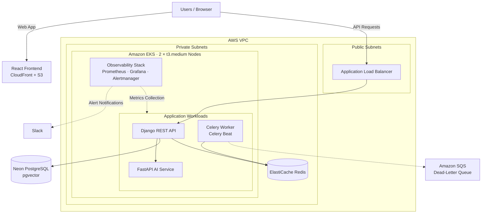
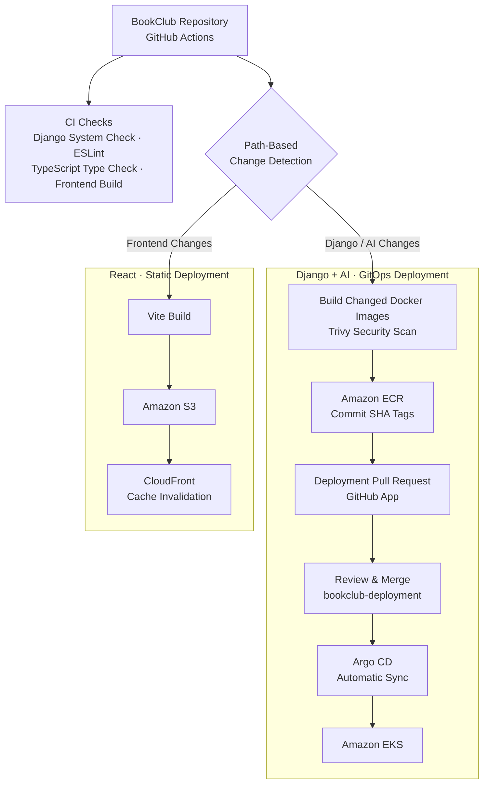

## Overview

BookClub is a full-stack book discovery and review platform inspired by Goodreads, where users can create their own lists, write and read reviews, and use semantic search to find their next reads.

The backend is built with Django and Django REST Framework, while the frontend uses React, TypeScript, and Vite. PostgreSQL on Neon provides persistent storage, with PostgreSQL full-text search, trigram similarity, and vector search powering book discovery.

The application runs on **Amazon EKS**, with Kubernetes managing the Django API, AI service, and Celery workloads. **Redis (Amazon ElastiCache)** serves as the Celery message broker, while **Amazon SQS** provides a dead-letter queue for failed asynchronous tasks. AWS infrastructure is provisioned using **Terraform**, while **Argo CD**, **Kustomize**, and **Helm** manage Kubernetes deployments through GitOps.

**GitHub Actions** validates the application, builds and publishes container images to Amazon ECR, and creates deployment pull requests in a separate GitOps repository. After review and merge, Argo CD synchronizes the updated manifests with the EKS cluster. The React frontend is hosted on Amazon S3 and delivered through CloudFront.

For observability, **Prometheus** collects application and Kubernetes metrics, **Grafana** provides monitoring dashboards, and **Alertmanager** delivers alerts through Slack.

The AI layer provides semantic search, book recommendations, AI-generated book summaries, and LLM-generated explanations for recommendations.

## Key Features

### Core Features

- Browse books, authors, genres, and series
- Search across books, authors, and genres
- View detailed book and author information
- Create and manage personal book lists
- Write, edit, and read book reviews
- Rate books
- User authentication and account management
- Discover recently added and randomly selected books

### AI & Search

- Semantic book search using vector embeddings
- Book recommendations based on book similarity
- AI-generated book summaries using the OpenAI Batch API
- LLM-generated explanations for book recommendations
- PostgreSQL full-text search and trigram similarity for traditional search
- Vector similarity search using PostgreSQL and pgvector

## BookClub v1.6 System Architecture

## BookClub v1.6 — CI/CD & GitOps Pipeline

BookClub uses **GitHub Actions** for CI/CD, with independent validation and path-based change detection to selectively trigger deployment jobs.

Pull requests run Django system checks, ESLint, TypeScript type checking, and frontend build validation. Changed Django and AI container images are also built and scanned with Trivy before merging.

On the `main` branch, changes to the Django backend or AI service trigger Docker image builds, Trivy security scans, and publishing to Amazon ECR using commit SHA tags. A **GitHub App** creates a pull request in the private GitOps repository to update the production Kustomize configuration. Once merged, **Argo CD** automatically synchronizes the changes with Amazon EKS.

Frontend changes trigger a separate Vite build, deployment to Amazon S3, and CloudFront cache invalidation. Django static files are also collected and published to S3 as part of the backend build workflow.